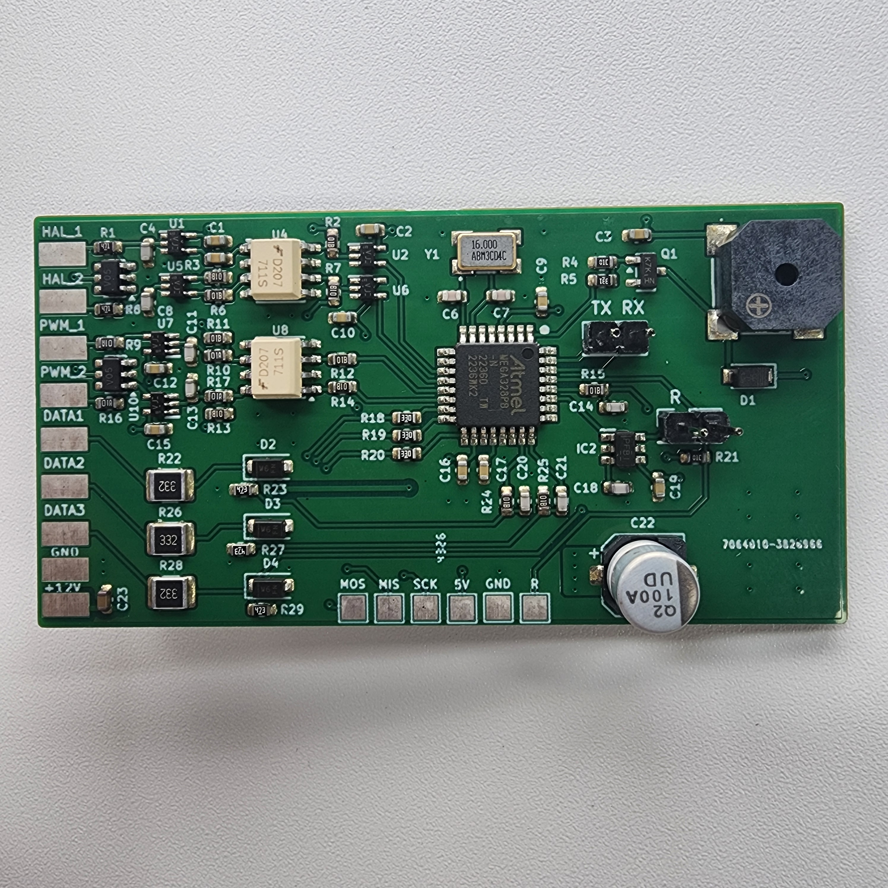
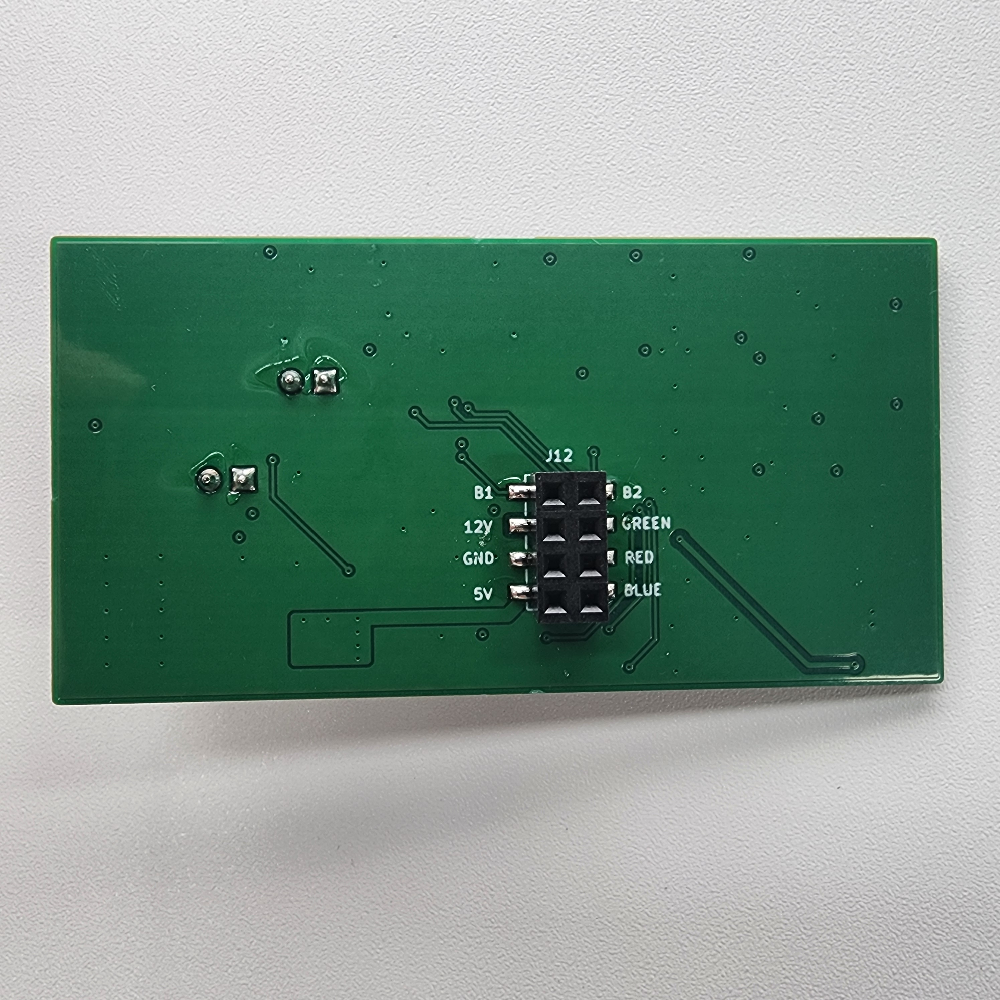
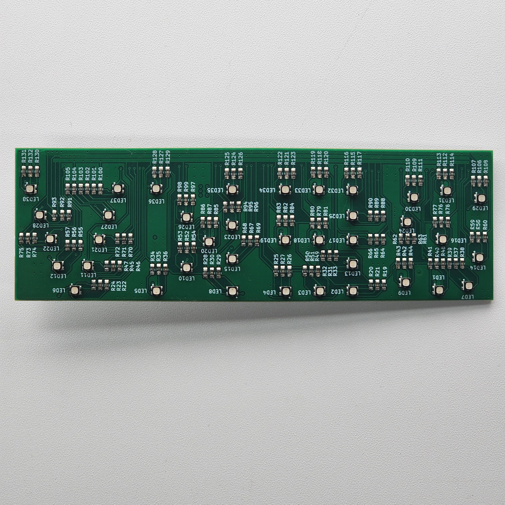
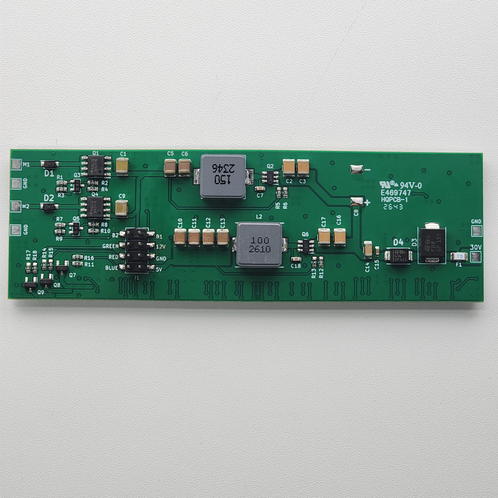

# Sterownik dwóch silników BLDC z sygnalizacją RGB

**Zleceniodawca:** Firma.

Projekt komercyjnego urządzenia elektronicznego do sterowania dwoma silnikami BLDC z sygnalizacją RGB.

**Technologie:** ATmega328PB | PWM | Czujniki Halla | RGB LED | DC/DC

**Zakres prac:** opracowanie schematów elektronicznych, dobór komponentów, projektowanie PCB oraz oprogramowanie mikrokontrolera.

## Pierwsza wersja prototypu

### Płytka sterownika BLDC

### Druga strona płytki sterownika

### Płytka sygnalizacji LED

### Płytka zasilania

---

## Realizacja projektu

Projekt został rozwinięty od pierwszego prototypu do wersji produkcyjnej. Urządzenie zostało wyprodukowane w liczbie około **300 egzemplarzy**.

Ze względu na komercyjny charakter projektu końcowa wersja urządzenia oraz pełna dokumentacja techniczna nie są udostępniane publicznie.

**Projekt i opracowanie elektroniki:** Radek Piątkowski
