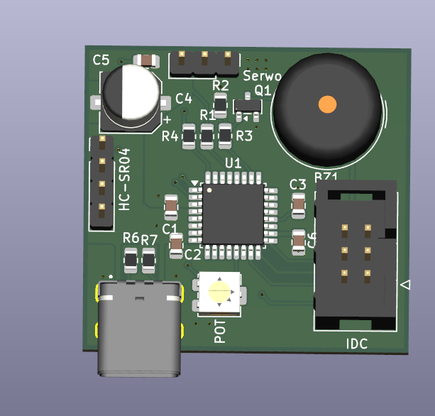

# Projekt edukacyjny – płytka sterująca z mikrokontrolerem

**Zleceniodawca:** Klient indywidualny – osoba prywatna.

Projekt płytki PCB wykonany na indywidualne zamówienie studentki na potrzeby projektu edukacyjnego.

Układ został zaprojektowany z myślą o integracji mikrokontrolera z elementami wykonawczymi i czujnikami.

**Główne elementy projektu:**
- Mikrokontroler.
- Złącze do czujnika ultradźwiękowego HC-SR04.
- Złącze sterowania serwomechanizmem.
- Potencjometr.
- Sygnalizator dźwiękowy.
- Złącza USB-C oraz IDC.

**Zakres wykonanych prac:**
- Opracowanie schematu elektronicznego.
- Dobór komponentów.
- Projektowanie płytki PCB.
- Przygotowanie dokumentacji produkcyjnej.

## Wizualizacja 3D płytki PCB

---

**Rodzaj projektu:** edukacyjny, wykonany na indywidualne zamówienie.

**Projektant elektroniki i PCB:** Radek Piątkowski

*Pełna dokumentacja techniczna oraz pliki produkcyjne nie są udostępniane publicznie.*
