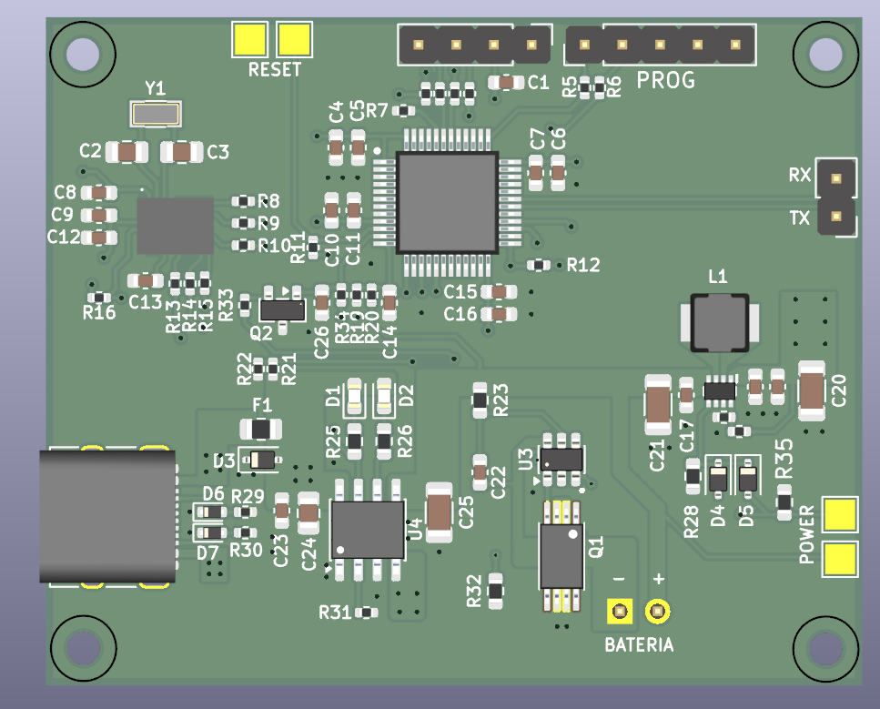

# Elektroniczny system pomiaru kąta i zakresu ruchu

**Zleceniodawca:** Klient indywidualny – osoba prywatna.

Projekt urządzenia elektronicznego przeznaczonego do pomiaru kątów oraz zakresu ruchu, w tym monitorowania zmian położenia i ruchomości stawów.

Układ został zaprojektowany z myślą o zastosowaniach wymagających pomiaru położenia kątowego oraz analizy zakresu wykonywanych ruchów.

## Główne rozwiązania

- Mikrokontroler odpowiedzialny za przetwarzanie danych pomiarowych.
- Układ do pomiaru położenia kątowego.
- Pomiar i monitorowanie zakresu ruchu.
- Zasilanie akumulatorowe.
- Złącze USB-C.
- Przetwornica DC/DC.
- Układ BMS do zarządzania i zabezpieczenia akumulatora.
- Interfejsy komunikacyjne i programujące.
- Dedykowana płytka PCB z komponentami SMD.

## Zakres wykonanych prac

- Opracowanie schematu elektronicznego.
- Dobór komponentów.
- Projektowanie płytki PCB.
- Opracowanie układu zasilania akumulatorowego.
- Przygotowanie plików produkcyjnych.

---

## Wizualizacja 3D płytki PCB

---

## Informacje o projekcie

Projekt elektronicznego systemu umożliwiającego pomiar kątów i zakresu ruchu.

**Projektant elektroniki i PCB:** Radek Piątkowski

*Przedstawiona grafika prezentuje projekt płytki PCB. Pełna dokumentacja techniczna oraz pliki produkcyjne nie są udostępniane publicznie.*
