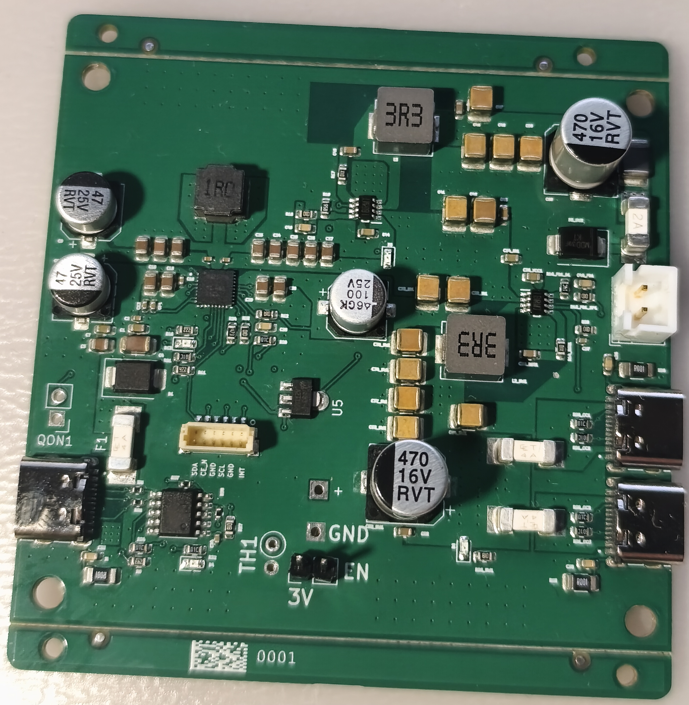
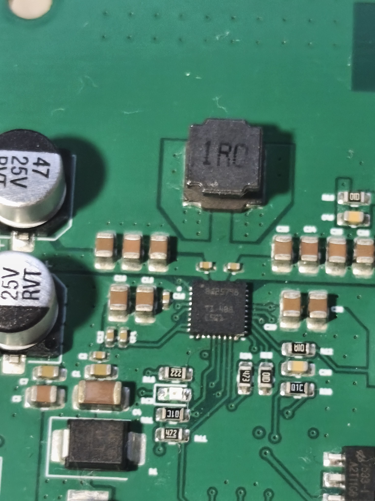

# Zasilacz Raspberry Pi z USB-C Power Delivery i Power Path

**Zleceniodawca:** Klient indywidualny – osoba prywatna.

Projekt układu zasilania Raspberry Pi, wykorzystującego technologię USB-C Power Delivery, dwie przetwornice DC/DC oraz układ zarządzania energią BQ z funkcją Power Path.

**Główne rozwiązania:**
- Obsługa USB-C Power Delivery.
- Dwie przetwornice DC/DC.
- Układ BQ do zarządzania ładowaniem akumulatora i torem zasilania (Power Path).
- Projekt schematu elektronicznego i płytki PCB.

## Wykonana płytka PCB

## Układ zarządzania zasilaniem

---

**Zakres prac:** opracowanie schematu elektronicznego, dobór komponentów oraz projektowanie PCB.

**Autor projektu:** Radek Piątkowski

*Projekt przedstawia prototyp urządzenia. Pełna dokumentacja techniczna nie jest udostępniana publicznie.*
