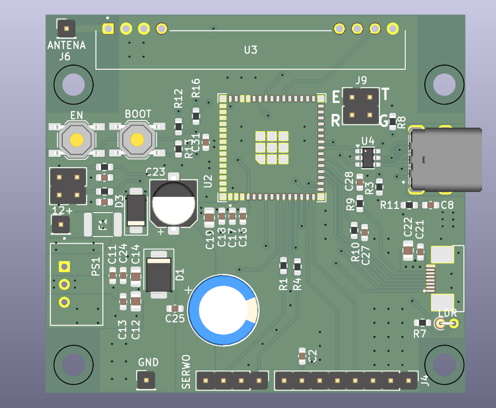

# Elektroniczny sterownik pozycjonowania przetwornika echosondy

**Zleceniodawca:** Klient indywidualny – osoba prywatna.

**Status projektu:** W trakcie realizacji – wczesny etap projektowania i prototypowania.

Projekt znajduje się obecnie na **początkowym etapie realizacji**. Przedstawiona wizualizacja PCB prezentuje pierwszą wersję konstrukcji, która będzie podlegać dalszym modyfikacjom, testom i udoskonaleniom.

## Opis projektu

Projekt dedykowanej płytki PCB przeznaczonej do sterowania położeniem przetwornika echosondy zamontowanego na łodzi.

Układ ma umożliwiać zdalne sterowanie serwomechanizmem odpowiedzialnym za ustawienie przetwornika, bez konieczności ręcznej regulacji.

## Główne rozwiązania

- **ESP32** – mikrokontroler odpowiedzialny za sterowanie urządzeniem.
- **RXB6 433 MHz** – odbiornik radiowy do komunikacji z pilotem.
- **Sterowanie serwomechanizmem** – regulacja położenia przetwornika echosondy.
- **Zasilanie 12 V DC** – zasilanie z instalacji łodzi.
- **Przetwornica DC/DC** – zasilanie układów elektronicznych.
- **USB-C** – złącze do podłączenia urządzenia.
- **Dedykowana płytka PCB** – integracja układów sterowania, zasilania i komunikacji.

## Planowana zasada działania

Sterownik będzie odbierał polecenia przesyłane drogą radiową za pomocą odbiornika RXB6 pracującego na częstotliwości 433 MHz.

Mikrokontroler ESP32 będzie przetwarzał odebrane sygnały i sterował serwomechanizmem odpowiedzialnym za zmianę położenia przetwornika echosondy.

## Zakres prac projektowych

- Opracowanie schematu elektronicznego.
- Dobór komponentów elektronicznych.
- Projektowanie dedykowanej płytki PCB.
- Integracja układu komunikacji radiowej.
- Projektowanie układów sterowania serwomechanizmem.
- Opracowanie sekcji zasilania.
- Przygotowanie plików produkcyjnych PCB.

---

## Wstępna wersja PCB

Wizualizacja 3D pierwszej wersji płytki sterownika pozycjonowania przetwornika echosondy.

Przedstawiona konstrukcja będzie podlegać dalszym modyfikacjom i testom.

---

## Informacje o realizacji

Projekt pozostaje na wczesnym etapie realizacji. Przedstawiona wizualizacja prezentuje aktualną koncepcję konstrukcji elektronicznej, a nie gotowe i przetestowane urządzenie.

**Projektant elektroniki i PCB:** Radek Piątkowski

*Pełna dokumentacja techniczna, schematy elektroniczne oraz pliki produkcyjne nie są udostępniane publicznie.*
