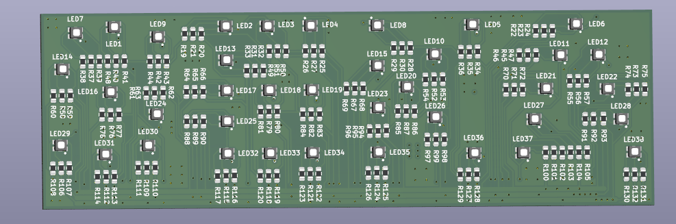
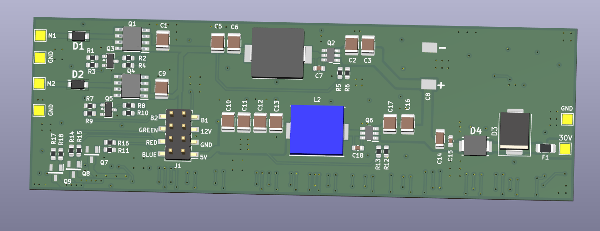
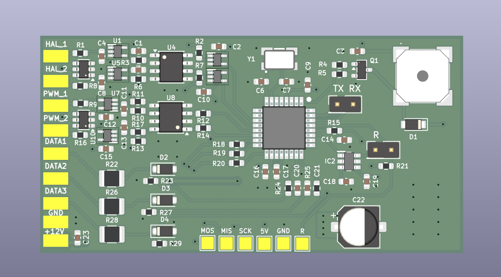

# MICROAIR — sterownik dwóch silników BLDC z sygnalizacją RGB

**Klient:** MICROAIR Sp. z o.o.  
**Rodzaj projektu:** realizacja komercyjna dla branży automotive  
**Zakres:** projekt sterownika dwóch silników BLDC wraz z układem zasilania i dedykowanymi płytkami PCB

## Opis projektu

W ramach projektu zaprojektowałem dwie współpracujące ze sobą płytki PCB, połączone za pomocą złączy goldpin.

Układ został zaprojektowany do zastosowania w pojeździe i odpowiada za sterowanie dwoma silnikami BLDC, pomiar ich prędkości na podstawie sygnałów z czujników Halla oraz wizualizację różnicy prędkości za pomocą diod RGB.

## Płyta zasilająco-sygnalizacyjna

Pierwsza płytka odpowiada za zasilanie układu, zasilanie silników oraz sygnalizację RGB.

Układ jest zasilany napięciem **30 V DC**. Na płytce znajdują się dwie przetwornice DC/DC generujące napięcia:

- **12 V** — dla części związanej z napędami BLDC,
- **5 V** — dla elektroniki sterującej.

Jedna strona płytki zawiera sekcję zasilania i przetwornice, natomiast po drugiej stronie znajdują się diody RGB tworzące wizualny wskaźnik różnicy prędkości obu silników.

### Strona z diodami RGB

Diody RGB pokazują aktualną różnicę prędkości pomiędzy silnikami. Kolor zależy od wartości oraz kierunku uchybu.

### Strona z sekcją zasilania

Na tej stronie znajdują się przetwornice DC/DC oraz elementy odpowiedzialne za dystrybucję zasilania w układzie.

## Płyta sterująca

Druga płytka pełni funkcję głównego sterownika urządzenia.

Układ został oparty na mikrokontrolerze **ATmega328PB**, który odpowiada za:

- sterowanie dwoma silnikami BLDC,
- generowanie sygnałów PWM,
- odczyt sygnałów z czujników Halla,
- pomiar prędkości obrotowej obu silników,
- porównywanie ich prędkości,
- wyznaczanie wartości i kierunku uchybu,
- sterowanie sygnalizacją RGB.

W zależności od różnicy prędkości układ zmienia kolor podświetlenia:

- **czerwony** — jeden z silników pracuje szybciej od drugiego,
- **niebieski** — różnica występuje w przeciwnym kierunku,
- **zielony** — prędkości obu silników są zgodne w przyjętym zakresie tolerancji.

## Mój zakres prac

W projekcie odpowiadałem za:

- opracowanie koncepcji elektroniki,
- zaprojektowanie dwóch płytek PCB,
- zaprojektowanie sekcji zasilania **30 V / 12 V / 5 V**,
- dobór komponentów,
- projekt układu sterującego z mikrokontrolerem ATmega328PB,
- realizację sterowania silnikami BLDC za pomocą PWM,
- obsługę sygnałów z czujników Halla,
- pomiar i porównywanie prędkości obu silników,
- sterowanie diodami RGB na podstawie różnicy prędkości,
- przygotowanie dokumentacji produkcyjnej,
- uruchomienie i testowanie prototypu,
- wprowadzanie poprawek po testach.

## Wdrożenie

Projekt został wdrożony komercyjnie i wykorzystany w rozwiązaniu przeznaczonym dla branży automotive.

Na podstawie przygotowanego projektu klient wyprodukował około **300 kompletów płytek PCB**.

## Poufność

Ze względu na komercyjny charakter projektu publikuję wyłącznie wizualizacje PCB oraz zdjęcia wykonanych płytek.

Schematy elektryczne, pliki produkcyjne, kod źródłowy oraz pozostała dokumentacja techniczna nie są udostępniane publicznie.
